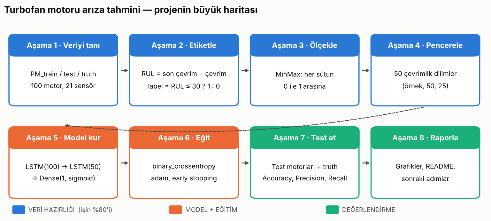

# ML for ME — Makine Mühendisleri için Uygulamalı Makine Öğrenmesi

**Proje:** Turbofan uçak motorunun sensör verisine bakıp *"Bu motor önümüzdeki 30 çevrim içinde arızalanır mı?"* sorusunu cevaplayan bir model.
Bu, makine mühendisliğindeki en yaygın ML kullanımlarından biri: **kestirimci bakım (predictive maintenance)**.

- **Referans proje:** [umbertogriffo/Predictive-Maintenance-using-LSTM](https://github.com/umbertogriffo/Predictive-Maintenance-using-LSTM) (⭐ 700+, MIT lisansı)
- **Veri:** NASA C-MAPSS turbofan bozulma simülasyonu (FD001 alt kümesi), ~5,7 MB metin dosyası
- **Model:** Keras LSTM (zaman serisi okuyabilen sinir ağı)



🎬 **Eğitim videosu (86 sn):** [video/out/ml_for_me_egitim.mp4](video/out/ml_for_me_egitim.mp4), Remotion ile gerçek veriden üretildi. Yeniden render: `cd video && npm install && npm run render`

## İlerleme

| Aşama | Konu | Durum | Ders notu |
|---|---|---|---|
| 1 | Veriyi tanı | ✅ | [docs/ders_01_veriyi_tani.md](docs/ders_01_veriyi_tani.md) |
| 2 | Etiketle (RUL ve label) | ✅ | [docs/ders_02_etiketle.md](docs/ders_02_etiketle.md) |
| 3 | Ölçekle (MinMax) | ✅ | [docs/ders_03_olcekle.md](docs/ders_03_olcekle.md) |
| 4 | Pencerele (50 çevrimlik diziler) | ✅ | [docs/ders_04_pencerele.md](docs/ders_04_pencerele.md) |
| 5 | Modeli kur (LSTM) | ✅ | [docs/ders_05_model.md](docs/ders_05_model.md) |
| 6 | Eğit (canlı takip) | ✅ | [docs/ders_06_egit.md](docs/ders_06_egit.md) · [teknik derinlik](docs/ders_06b_derin_ogrenme_teknik.md) |
| 7 | Test et (precision, recall) | ✅ | [docs/ders_07_test.md](docs/ders_07_test.md) |
| 8 | Raporla ve sonraki adımlar | ⏳ sırada | |

## Klasörler

```
ML_for_ME/
├── data/                  ← ham veri (dokunmuyoruz)
│   ├── PM_train.txt       100 motor, arızaya kadar tüm çevrimler  (20.631 satır)
│   ├── PM_test.txt        100 başka motor, arızadan önce kesilmiş (13.096 satır)
│   └── PM_truth.txt       test motorlarının gerçekte kaç çevrim daha dayandığı (100 satır)
├── src/
│   ├── train_binary.py    ← veri → pencere → model → eğitim (Aşama 1-6)
│   └── evaluate_binary.py ← test motorlarında değerlendirme (Aşama 7)
├── tools/
│   ├── make_figures.py    ← ders görsellerini üretir (eğitimin parçası değil)
│   └── inside_the_model.py← modeli numpy ile elle hesaplar, tek eğitim adımını gösterir
├── docs/                  ← her aşamanın ders notu + görseller
├── video/                 ← Remotion projesi (11 sahnelik özet video)
└── outputs/               ← eğitilmiş model, eğitim eğrileri, loglar
    ├── binary_model.keras     en iyi model (epoch 44)
    ├── training_log.csv       epoch epoch loss / accuracy / recall
    ├── training_progress.png  canlı eğitim grafiği
    ├── test_predictions.csv   93 test motorunun tahminleri
    └── confusion_matrix.png, test_engines.png, threshold_sweep.png
```

## Kurulum ve çalıştırma

```bash
pip install -r requirements.txt
python src/train_binary.py      # eğit (~5 dk, CPU)
python src/evaluate_binary.py   # test et
```

## Sonuç (93 test motoru, eşik 0.5)

| accuracy | precision | recall | F1 |
|---|---|---|---|
| 0.957 | 1.000 | 0.840 | 0.913 |

Eşik 0.2'de boş alarm eklemeden recall 0.92'ye çıkıyor (bkz. [Ders 7](docs/ders_07_test.md)).

## Kaynak ve lisans

Veri dosyaları referans projeden alındı (MIT, © 2019 Umberto Griffo). Verinin asıl kaynağı NASA Ames Prognostics Center of Excellence'ın C-MAPSS veri setidir
(A. Saxena, K. Goebel, D. Simon, N. Eklund, "Damage Propagation Modeling for Aircraft Engine Run-to-Failure Simulation", PHM 2008).
