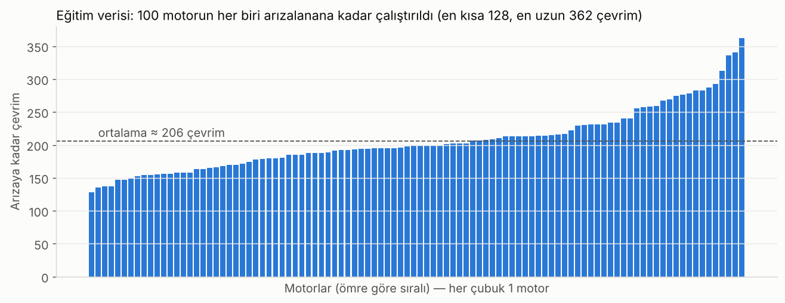
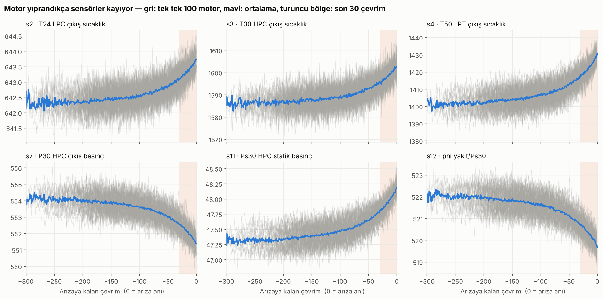
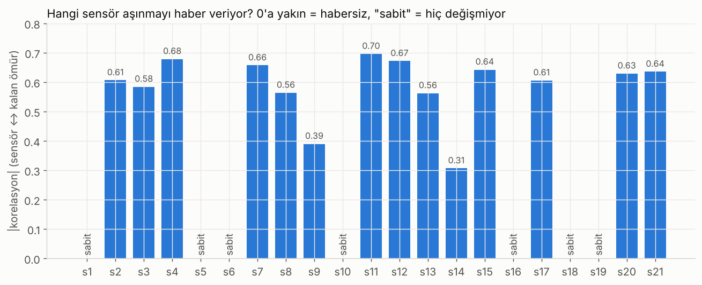

# Ders 1 · Veriyi tanı

## Problem ne?

Bir uçak motoru her uçuşta (1 **çevrim**) biraz yıpranır. Yıprandıkça kompresör ve türbin verimi düşer;
aynı itkiyi vermek için motor daha sıcak çalışır, basınçlar kayar. Sensörler bunu "fısıldar".
Biz bu fısıltıyı dinleyip arızadan **önce** uyarı veren bir model kuracağız.

> Mühendislik karşılığı: Bakımı ne çok erken (para kaybı) ne çok geç (arıza) yapmak.
> Bu fikir pompa, rulman, kompresör, CNC iş mili gibi her döner ekipmana aynen uygulanır.

## Dosyalar

| Dosya | Satır | Ne var? |
|---|---|---|
| `PM_train.txt` | 20.631 | 100 motor. Her biri ilk çevrimden **arıza anına kadar** kayıtlı. |
| `PM_test.txt` | 13.096 | 100 farklı motor. Kayıt arızadan **önce bir yerde kesilmiş**. |
| `PM_truth.txt` | 100 | Test motorlarının kayıt kesildikten sonra **kaç çevrim daha** dayandığı. |

## Bir satır = bir motorun bir çevrimdeki fotoğrafı

| Sütun | Anlamı |
|---|---|
| `id` | Motor numarası (1–100) |
| `cycle` | Kaçıncı çevrim |
| `setting1-3` | Çalışma ayarları (irtifa, Mach, gaz kolu benzeri) |
| `s1 … s21` | Sensörler: sıcaklıklar, basınçlar, devirler, oranlar |

Önemli sensörler (makine mühendisi gözüyle):

| Sensör | Ölçtüğü | Yıprandıkça |
|---|---|---|
| s2 | T24 — düşük basınç kompresörü (LPC) çıkış sıcaklığı | artar |
| s3 | T30 — yüksek basınç kompresörü (HPC) çıkış sıcaklığı | artar |
| s4 | T50 — düşük basınç türbini (LPT) çıkış sıcaklığı | artar |
| s7 | P30 — HPC çıkış basıncı | düşer |
| s11 | Ps30 — HPC çıkış statik basıncı | artar |
| s12 | phi — yakıt debisi / Ps30 | düşer |

## Gördüklerimiz



Motorlar aynı tip ama ömürleri 128 ile 362 çevrim arasında değişiyor. Yani "her motor 200 çevrimde bozulur" diyemeyiz; sensöre bakmak zorundayız.



Arızaya yaklaştıkça sensörler belirgin şekilde kayıyor (sıcaklıklar artıyor, P30 düşüyor). Model tam olarak bu kaymayı öğrenecek.
Ama tek tek motorlar (gri) çok gürültülü; tek bir ölçüme bakarak karar vermek zor. Bu yüzden ileride **son 50 çevrime birlikte** bakacağız.



s1, s5, s6, s10, s16, s18, s19 hiç (ya da neredeyse hiç) değişmiyor. Bu simülasyonda motorlar tek bir çalışma koşulunda uçtuğu için bu sensörler sabit kalıyor; bilgi taşımıyorlar.

## Kod (src/train_binary.py — Aşama 1)

```python
COLUMNS = ["id", "cycle", "setting1", "setting2", "setting3"] + [f"s{i}" for i in range(1, 22)]

def read_engine_file(name):
    df = pd.read_csv(DATA / name, sep=" ", header=None)  # boşlukla ayrılmış, başlık yok
    df = df.iloc[:, :26]                                  # satır sonundaki 2 boş sütunu at
    df.columns = COLUMNS                                  # sütunlara isim ver
    return df.sort_values(["id", "cycle"]).reset_index(drop=True)
```

Çıktı: `train: (20631, 26) | test: (13096, 26) | truth: (100, 1)`

## Kendini test et

1. Eğitim verisinde motor 1'in son satırı neyi temsil ediyor?
2. Test verisinde motor 1'in son satırı da arıza anı mı?
3. `PM_truth.txt` olmasaydı test sonucunu ölçebilir miydik?
