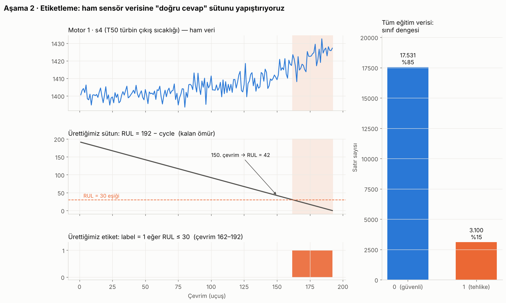

# Ders 2 · Etiketle

ML modeli bir öğrencidir; öğrenmesi için **soru + doğru cevap** çiftleri gerekir.
Sensör verisi "soru", ama "doğru cevap" sütunu dosyada yok. Onu biz üretiyoruz.



## 1. RUL (Remaining Useful Life, kalan ömür)

Eğitim verisinde her motorun **son satırı = arıza anı**. O hâlde:

```
RUL = o motorun son çevrimi − şu anki çevrim
```

Motor 1 192. çevrimde arızalandı → 150. çevrimde RUL = 192 − 150 = **42**.

```python
train_df["RUL"] = train_df.groupby("id")["cycle"].transform("max") - train_df["cycle"]
```

- `groupby("id")` → veriyi motor motor gruplara ayır
- `["cycle"].transform("max")` → her grubun en büyük çevrimini bul ve o grubun **her satırının yanına** yaz
- Dikkat: `max()` tek başına tüm tablonun maksimumunu (362) verirdi; bu yanlış olurdu. Her motorun kendi ömrü lazım.

## 2. Test verisinde RUL

Test motorlarının kaydı arızadan **önce** kesilmiş. `PM_truth.txt` kesildikten sonra kaç çevrim daha dayandığını söylüyor:

```
toplam ömür = son kayıtlı çevrim + truth
Motor 1: 31 + 112 = 143 çevrim
```

```python
truth_df["id"] = truth_df.index + 1
test_df = test_df.merge(truth_df, on="id")
test_df["RUL"] = test_df.groupby("id")["cycle"].transform("max") + test_df["more"] - test_df["cycle"]
```

`merge` = Excel'deki DÜŞEYARA (VLOOKUP): her test satırına kendi motorunun `more` değerini getirir.

## 3. Etiket

```python
W1 = 30
train_df["label"] = (train_df["RUL"] <= W1).astype(int)
```

`(RUL <= 30)` her satır için True/False üretir, `.astype(int)` bunu 1/0 yapar.

## Sınıf dengesizliği

| | Satır | Oran |
|---|---|---|
| 0 (güvenli) | 17.531 | %85 |
| 1 (tehlike) | 3.100 | %15 |

Hiçbir şey öğrenmeyen, her zaman "0" diyen tembel bir model bile %85 doğruluk alır.
Bu yüzden Aşama 7'de yalnızca **accuracy**'e değil, **precision** ve **recall**'a da bakacağız.

## Neden sınıflandırma (0/1), neden regresyon (kaç çevrim) değil?

- Bakım kararı zaten ikili: *bakıma al / alma*.
- 30 çevrim, parça siparişi ve hangar planı için gereken hazırlık süresi.
- Sınıflandırma daha kolay öğrenilir; ilk proje için ideal. Regresyon versiyonu (RUL'u sayı olarak tahmin) Aşama 8'de "sonraki adım".

## Kendini test et

1. `transform("max")` yerine `max()` yazsaydık ne olurdu?
2. Test motoru 2: 49 çevrim kayıtlı, truth = 98. Toplam ömür? Son kayıtlı satırın RUL'u? Etiketi?
3. Neden %85 doğruluk etkileyici bir sonuç değil?
