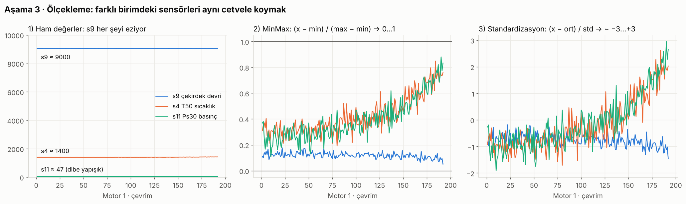

# Ders 3 · Ölçekle



## Neden?

Sinir ağı içeride `ağırlık × değer` toplar. s9 ≈ 9000, s11 ≈ 47 iken model başlangıçta s9'u
istemeden 200 kat "daha önemli" sanır. Oysa aşınmayı en iyi s11 haber veriyor (korelasyon 0.70, s9: 0.39).
Ölçekleme bütün sensörleri **aynı cetvele** koyar; kimin önemli olduğuna model kendisi karar verir.

## İki yöntem

| | Normalizasyon (MinMax) | Standardizasyon (Z-skor) |
|---|---|---|
| Formül | `(x − min) / (max − min)` | `(x − ortalama) / std` |
| Aralık | 0 … 1 (kesin) | çoğunlukla −3 … +3 |
| Aykırı değere (outlier) | hassas: tek bir uç değer bütün aralığı ezer | daha dayanıklı |
| Ne zaman? | Değerler sınırlı, uç değer az, ağ sigmoid/tanh kullanıyor | Veri çan eğrisine yakın, uç değer var, lineer modeller / SVM |

**Seçimimiz: MinMax.** Sensörlerimiz fiziksel olarak sınırlı, ciddi uç değer yok, LSTM içi kapılar 0–1 aralığında çalışıyor.
Referans proje de bunu kullanıyor. Grafikte görüldüğü gibi iki yöntem de **aynı şekli** korur, sadece cetvel değişir.

Mühendis benzetmesi: MinMax = interpolasyon (min → 0, max → 1). Z-skor = "ortalamadan kaç sigma uzaktayım?"

## Örnek hesap

s4 (T50): train min = 1382.25, max = 1441.49

```
(1427.20 − 1382.25) / (1441.49 − 1382.25) = 44.95 / 59.24 = 0.759
```

## Altın kural: min/max SADECE eğitim verisinden

```python
scaler = MinMaxScaler()
train_df[FEATURES] = scaler.fit_transform(train_df[FEATURES])  # öğren + uygula
test_df[FEATURES]  = scaler.transform(test_df[FEATURES])       # sadece uygula
```

- `fit` = cetveli ölç (min, max'ı öğren). **Yalnızca eğitimde.**
- `transform` = cetveli uygula.
- Test verisine `fit` yapmak = **veri sızıntısı (data leakage)**: modele gelecekten bilgi vermek. Sahada gelecekteki verinin max'ını bilemezsin.
- Sonuç: test verisi 0–1 dışına biraz taşabilir (bizde −0.044 … 1.081). Bu normal ve doğrudur.

## Sabit sensörler

s1, s5, s10, s16, s18, s19'da `max − min = 0` → formül `0/0` = **tanımsız (NaN)**.
(scikit-learn bu durumda sessizce 0 yazar; hata vermez ama sütun yine bilgi taşımaz.)
Çözüm: bu sütunları **hiç almamak**. s6 da (21.60 / 21.61, sadece yuvarlama gürültüsü) aynı gruba giriyor.
setting1-2 ise bu veri setinde tek çalışma koşulunun etrafındaki gürültü (RUL ile korelasyon ≈ 0.003), onları da almadık.

**Son özellik listesi (15):** `cycle_norm, s2, s3, s4, s7, s8, s9, s11, s12, s13, s14, s15, s17, s20, s21`

> Referans projeden farkımız: o 25 sütunun hepsini kullanıyor. Biz 15'e indirdik, model daha az gürültüyle uğraşacak.

## Kendini test et

1. `fit_transform`'u test verisine de uygulasaydık ne olurdu?
2. Bir sensörde tek bir bozuk ölçüm 99999 yazsa MinMax sonrası diğer değerler nereye sıkışır?
3. Neden `cycle`'ı değil, kopyası `cycle_norm`'u ölçekledik?
