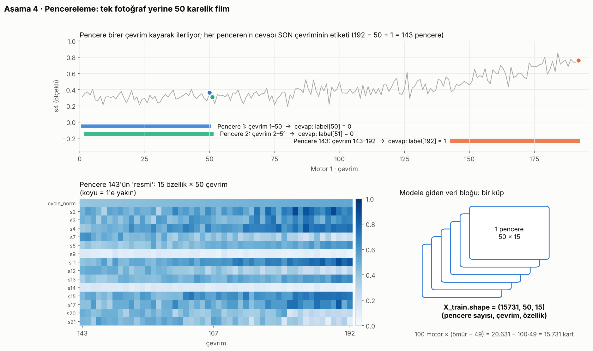

# Ders 4 · Pencerele



## Fikir: fotoğraf değil, film

Tek bir çevrimin ölçümü çok gürültülü (Ders 1, grafik 03). Doktor tek nabız ölçümüne değil, son haftaların grafiğine bakar.
Modele de **son 50 çevrimi birden** gösteriyoruz ve soruyoruz: *"Bu filmin son karesinde motorun etiketi ne?"*

## Soru-cevap

**S10 · 192 çevrimlik motordan kaç pencere çıkar?**
İlk pencere 1–50, son pencere 143–192 → **192 − 50 + 1 = 143 pencere.**
(Genel formül: `n − pencere + 1`.)

> Not: Referans projede pencerenin cevabı bir *sonraki* çevrimin etiketi olduğu için 142 pencere çıkıyor.
> Biz cevabı pencerenin *son* çevrimine bağladık; "şu an ne durumdayım?" sorusuyla birebir örtüşüyor.

**S11 · Veri bloğunun şekli?**
`(N, 50, 15)` = (pencere sayısı, çevrim, özellik). Eğitimde N = 20.631 − 100 × 49 = **15.731**.
Bir küp düşün: 15.731 kart, her kart 50 × 15'lik bir tablo.

**S12 · 50 çevrimden kısa test motorları (7 tane) ne olacak?**
Seçenekler:
1. **At** (referans projenin ve bizim seçimimiz): 100 test motorundan 93'ü kalır. Basit ve dürüst.
2. **Doldur (padding)**: Eksik başı 0 ya da ilk değerle doldur, modele `Masking` katmanıyla "bu kısım sahte" de.
3. **Daha kısa pencere** kullan (ör. 30). Bütün motorlar sığar ama model daha az geçmiş görür.

Mühendislik notu: 31 çevrimlik yeni bir motor zaten genelde tehlikede değildir. Pratikte "en az 50 çevrim veri olunca tahmin başlat" kuralı makul.

**S13 · Testte neden sadece son pencere?**
Havayolu şirketinin sorusu *"motorlarım **şu an** tehlikede mi?"*. Her motor için tek, güncel bir karar lazım.
Ayrıca truth dosyası tam olarak kaydın kesildiği an için verilmiş; en temiz değerlendirme o noktada yapılıyor.

## Kod

```python
SEQ_LEN = 50

def make_windows(df):
    X, y = [], []
    for _, engine in df.groupby("id"):                       # motor motor dolaş
        values = engine[FEATURES].to_numpy(dtype="float32")   # (çevrim, 15) matris
        labels = engine["label"].to_numpy(dtype="float32")
        for end in range(SEQ_LEN, len(engine) + 1):           # end = 50, 51, ..., 192
            X.append(values[end - SEQ_LEN:end])               # satır [end-50, end) → 50 satır
            y.append(labels[end - 1])                         # son satırın etiketi
    return np.array(X), np.array(y)
```

`values[a:b]` Python'da "a dahil, b hariç" demek. `end = 50` için `values[0:50]` → ilk 50 satır.

```python
def last_windows(df):
    ...
        if len(engine) < SEQ_LEN:   # S12: kısa motorları atla
            continue
        X.append(engine[FEATURES].to_numpy(dtype="float32")[-SEQ_LEN:])   # son 50 satır
        y.append(engine["label"].iloc[-1])                                # son satırın etiketi
```

`[-50:]` = "sondan 50 eleman". Negatif indeks sondan sayar.

## Sonuç

| | Şekil | Tehlike (1) oranı |
|---|---|---|
| `X_train` | (15731, 50, 15) | %19,7 |
| `X_test` | (93, 50, 15) | 25 / 93 motor |

Eğitimde tehlike oranı %15'ten %19,7'ye çıktı: ilk 49 çevrim (hep 0 olan kısım) pencereye cevap olamıyor.
