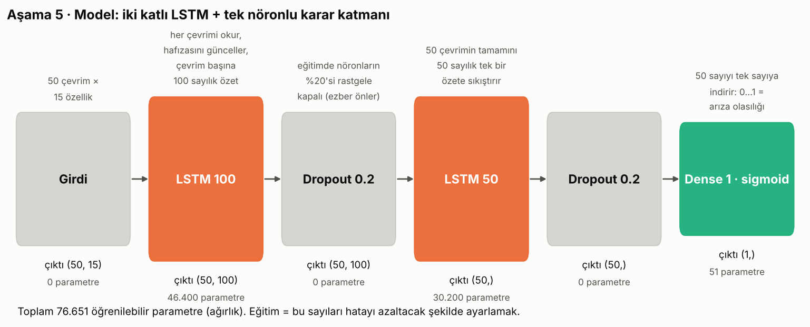

# Ders 5 · Modeli kur



## Neden LSTM?

Normal bir sinir ağı 50 × 15 = 750 sayıyı **sırasız bir torba** gibi görür. "Önce sıcaklık arttı, sonra basınç düştü" sırasını anlamaz.
**LSTM (Long Short-Term Memory)** veriyi zaman sırasıyla, çevrim çevrim okur ve okurken bir **hafıza** tutar:

```
çevrim 1 → hafızayı güncelle → çevrim 2 → hafızayı güncelle → ... → çevrim 50 → son hafıza = filmin özeti
```

Hafızanın içinde 3 kapı var (hepsi 0–1 arası çalışır, ölçeklemeyi bu yüzden 0–1 seçtik):
- **unut kapısı:** eski bilginin ne kadarını sileyim?
- **giriş kapısı:** yeni çevrimden ne kadar bilgi alayım?
- **çıkış kapısı:** hafızadan ne kadarını dışarı vereyim?

Mühendis benzetmesi: Bir **hareketli ortalama filtresi** düşün, ama ağırlıkları sabit değil; veriye bakarak kendisi öğreniyor.

## Katman katman

```python
model = keras.Sequential([
    keras.Input(shape=(50, 15)),
    keras.layers.LSTM(100, return_sequences=True),
    keras.layers.Dropout(0.2),
    keras.layers.LSTM(50),
    keras.layers.Dropout(0.2),
    keras.layers.Dense(1, activation="sigmoid"),
])
```

| Katman | Ne yapar | Çıktı | Parametre |
|---|---|---|---|
| `Input(50, 15)` | Kapı: "bana 50 × 15'lik kartlar gelecek" | (50, 15) | 0 |
| `LSTM(100, return_sequences=True)` | Her çevrimde 100 sayılık hafıza. `return_sequences=True` → 50 çevrimin hepsinin özetini sonraki katmana ver | (50, 100) | 46.400 |
| `Dropout(0.2)` | Eğitimde her adımda nöronların %20'sini rastgele kapat → model tek bir nörona bel bağlayıp ezberleyemez | (50, 100) | 0 |
| `LSTM(50)` | İkinci okuma, bu sefer sadece **son** hafızayı ver | (50,) | 30.200 |
| `Dense(1, sigmoid)` | 50 sayının ağırlıklı toplamı + sigmoid → 0…1 arası **arıza olasılığı** | (1,) | 51 |

Parametre hesabı (merak edenlere): LSTM'de 4 iç birim var → `4 × (birim × (girdi + birim) + birim)`.
LSTM 100: 4 × (100 × (15 + 100) + 100) = 46.400.

**Sigmoid**: `1 / (1 + e^(−x))`. Her sayıyı 0 ile 1 arasına sıkıştırır. Çıktı 0.5'ten büyükse "tehlike" diyeceğiz.

## Derleme (compile): "nasıl öğreneceksin?"

```python
model.compile(loss="binary_crossentropy", optimizer="adam",
              metrics=["accuracy", keras.metrics.Recall(name="recall")])
```

| Ayar | Mala anlatır gibi |
|---|---|
| `loss="binary_crossentropy"` | Hata cetveli. Gerçek 1 iken 0.9 dersen az, 0.1 dersen **çok** ceza. Emin ama yanlış olmayı sert cezalandırır. |
| `optimizer="adam"` | Hatayı azaltmak için 76.651 ağırlığı hangi yöne, ne kadar çevireceğine karar veren usta. Dağdan sisli havada en dik iniş yönünü hissederek inmek gibi (gradient descent). |
| `metrics` | Sadece bizim izlememiz için. Accuracy + Recall (Ders 2'deki dengesizlik yüzünden recall'u da izliyoruz). |
