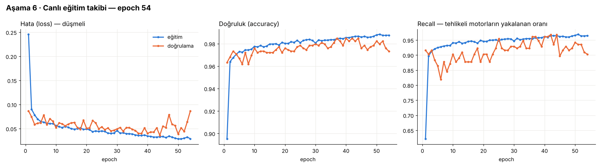

# Ders 6 · Eğit



## Eğitim döngüsü, mala anlatır gibi

```
1 epoch = bütün 15.731 pencereyi modele bir kez göstermek
  └─ 200'lük paketler (batch) hâlinde: 15.731 × 0.95 / 200 ≈ 75 adım
       her adımda: tahmin et → hatayı ölç (loss) → 76.651 ağırlığı biraz düzelt (adam)
```

| Terim | Anlamı | Bizde |
|---|---|---|
| **epoch** | Veri setinin tamamının bir kez üzerinden geçmek | en fazla 100 |
| **batch** | Ağırlıkları güncellemeden önce kaç örneğe bakılacağı | 200 |
| **validation_split** | Eğitime hiç girmeyen, her epoch sonunda yapılan "ara sınav" | son %5 → son ~5 motor |
| **EarlyStopping** | Ara sınav notu (val_loss) 10 epoch boyunca iyileşmezse dur, en iyi ağırlıklara dön | 54. epoch'ta durdu, en iyisi 44 |
| **ModelCheckpoint** | En iyi modeli diske kaydet | `outputs/binary_model.keras` |

### Neden doğrulama verisi "son %5"?

Komşu pencereler 49 çevrimi paylaşıyor; neredeyse aynı kartlar. Rastgele %5 seçseydik, ara sınav soruları ders kitabındaki soruların
kopyası olurdu (sızıntı!). Keras `validation_split` karıştırmadan **sondaki** örnekleri alıyor: bizde bunlar son ~5 motorun tamamı.
Yani model ara sınavda **hiç görmediği motorlarla** sınanıyor.

## Grafiği okumak

- **İlk 2 epoch:** loss 0.25 → 0.09. Model bariz kalıbı (sıcaklık artıyor = tehlike) hemen kaptı.
- **Epoch 2–44:** İkisi birlikte yavaşça iyileşiyor. Asıl ince öğrenme burada.
- **Epoch 44 sonrası:** Mavi (eğitim) düşmeye devam ediyor, turuncu (doğrulama) zıplamaya ve yükselmeye başlıyor.
  Bu **aşırı öğrenme (overfitting)**: model genel kuralı değil, eğitim motorlarının kendine has gürültüsünü ezberlemeye başladı.
  EarlyStopping tam bunu yakalayıp 10 epoch bekledi ve durdu.

> Benzetme: Sınava çalışan öğrenci önce konuyu öğrenir (iki not da artar). Bir noktadan sonra aynı soruların cevaplarını
> ezberlemeye başlar: çalıştığı kitaptan tam alır, yeni sorularda düşer. En iyi an, ezber başlamadan hemen önceki an.

## Sonuç (en iyi epoch: 44)

| | Eğitim | Doğrulama (görülmemiş 5 motor) |
|---|---|---|
| loss | 0.033 | 0.036 |
| accuracy | %98,7 | %98,5 |
| recall | %96,5 | %96,8 |

Süre: 54 epoch, CPU'da yaklaşık 5 dakika (epoch başına ~5–6 sn).

## Canlı takip nasıl yapıldı?

`LiveProgress` adında küçük bir callback yazdık. Keras her epoch sonunda onu çağırıyor; o da:
1. Değerleri listeye ekliyor,
2. `outputs/training_progress.png` grafiğini yeniden çiziyor,
3. Konsola tek satır özet basıyor.

`CSVLogger` ise aynı sayıları `outputs/training_log.csv` dosyasına yazıyor (Excel'de açılabilir).

## Kendini test et

1. Eğitim loss'u düşerken doğrulama loss'u artıyorsa ne oluyor?
2. `patience=10` yerine `patience=1` olsaydı ne olurdu?
3. Doğrulama için neden rastgele değil de sondaki motorları kullanmak daha dürüst?
