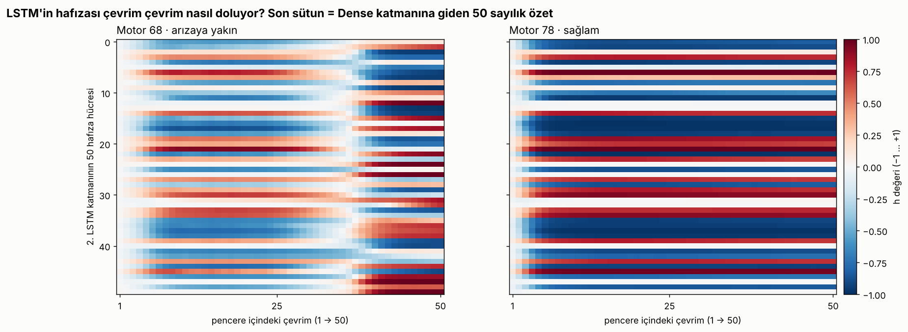
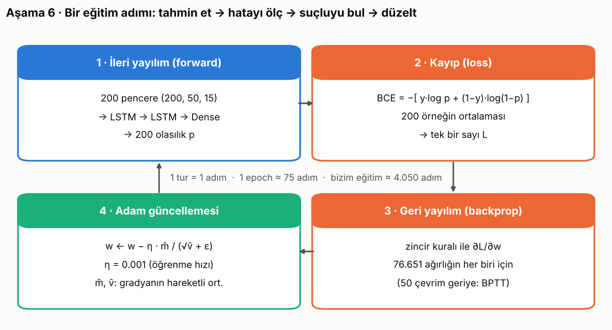

# Ders 6b · Teknik derinlik: modelleme ve eğitim

## Bu bir deep learning modeli mi?

**Evet.** Küçük ama gerçek bir derin öğrenme modeli.

```
Yapay Zekâ  ⊃  Makine Öğrenmesi  ⊃  Derin Öğrenme
(kural yazan    (kuralı veriden      (kuralı veriden ÇOK KATMANLI sinir ağıyla öğrenen;
 her sistem)     öğrenen)             özellikleri de kendisi çıkaran)
```

| | Klasik ML (lojistik regresyon) | Derin öğrenme (bizim LSTM) |
|---|---|---|
| Girdi | Tek satır: 15 sayı | 50 × 15 = 750 sayı (zaman sıralı) |
| Model | `p = σ(w·x + b)` tek denklem | 2 LSTM katmanı + Dense; 50 zaman adımına açılınca ~100 adımlık hesap zinciri |
| Parametre | 16 | 76.651 |
| Özellik mühendisliği | Trend, eğim, ortalama gibi şeyleri **sen** hesaplamalısın | Trendleri **kendisi** keşfeder |
| Eğitim | Saniyeler, kapalı form yakınsama | Dakikalar, geri yayılım + Adam |
| Test sonucu (bizde) | recall 0.72, F1 0.84 | recall 0.84, F1 0.91 |

"Derin" kelimesi iki yönden geçerli:
1. **Katman derinliği:** LSTM(100) → LSTM(50) → Dense, üst üste 3 öğrenen katman.
2. **Zaman derinliği:** LSTM 50 çevrimi sırayla işler. Hata sinyali geri yayılırken 50 adım geriye gider (*backpropagation through time*).

## 1. Veri şekilleri (tensörler)

```
X_train : (15731, 50, 15)    pencere × çevrim × özellik
batch   : (  200, 50, 15)    bir adımda işlenen dilim
LSTM-1  : (  200, 50, 100)   her çevrim için 100 sayılık durum
LSTM-2  : (  200, 50)        sadece son çevrimin 50 sayılık durumu
Dense   : (  200, 1)         olasılık
```

## 2. LSTM hücresinin matematiği

Her çevrim `t` için, `x_t` (15 sayı) ve önceki durum `h_{t−1}` (100 sayı) kullanılarak:

```
z   = x_t · W  +  h_{t−1} · U  +  b          W: (15, 400)  U: (100, 400)  b: (400)
i_t = σ(z[  0:100])    giriş kapısı    → yeni bilgiden ne kadar alayım?
f_t = σ(z[100:200])    unut kapısı     → eski hafızanın ne kadarını tutayım?
g_t = tanh(z[200:300]) aday bilgi      → yazılacak yeni içerik (−1…1)
o_t = σ(z[300:400])    çıkış kapısı    → hafızanın ne kadarını göstereyim?

c_t = f_t ⊙ c_{t−1} + i_t ⊙ g_t       hücre hafızası (uzun süreli)
h_t = o_t ⊙ tanh(c_t)                  gizli durum (dışarı verilen)
```

`σ` = sigmoid (0…1), `⊙` = eleman eleman çarpım. 400 = 4 kapı × 100 birim.

**Mühendis gözüyle:** `c_t = f·c_{t−1} + i·g`, birinci dereceden bir **ayrık zaman filtresi** (`y_k = a·y_{k−1} + b·u_k`).
Tek fark şu: `a` (= f) ve `b` (= i) sabit değil, her adımda girdiye bakılarak hesaplanıyor. Model, hangi sensör hareketinin
hafızaya yazılacağına ve ne zaman unutulacağına kendisi karar veriyor.

**Neden kapılı?** Basit RNN'de (`h_t = tanh(x·W + h·U)`) hata sinyali 50 adım geriye giderken her adımda `U` ile çarpılıp
sönümlenir (*vanishing gradient*). LSTM'de `c_t` yolu toplama üzerinden ilerlediği için sinyal 50 adım geriye taşınabilir.

### Parametre sayısı

| Katman | Formül | Sayı |
|---|---|---|
| LSTM-1 | 4 × (100·15 + 100·100 + 100) | 46.400 |
| LSTM-2 | 4 × (50·100 + 50·50 + 50) | 30.200 |
| Dense | 50·1 + 1 | 51 |
| **Toplam** | | **76.651** |

### Kara kutu değil: numpy ile elle doğrulama

`tools/inside_the_model.py` eğitilmiş ağırlıkları alıp yukarıdaki formülleri düz numpy ile hesaplıyor:

```
motor  68 (arızaya yakın) | numpy: 0.999988 | keras: 0.999988 | logit: +11.34
motor  78 (sağlam       ) | numpy: 0.000001 | keras: 0.000001 | logit: -13.45
```

Sonuç birebir aynı. Model sadece çarpma, toplama, sigmoid ve tanh'tan oluşuyor.



Sağlam motorda (sağ) hafıza ilk birkaç çevrimde oturuyor ve sabit kalıyor. Arızaya yakın motorda (sol) pencerenin ~37. çevriminde
birçok hücre **işaret değiştiriyor**: model "rejim değişti" diye not alıyor. Son sütundaki 50 sayı Dense katmanına gidiyor.

## 3. Çıkış ve kayıp fonksiyonu

```
logit = h_50 · w + b          (50 sayının ağırlıklı toplamı, −∞…+∞)
p     = σ(logit) = 1 / (1 + e^(−logit))

BCE(y, p) = −[ y·ln(p) + (1−y)·ln(1−p) ]
```

| Gerçek y | Tahmin p | Kayıp | Yorum |
|---|---|---|---|
| 1 | 0.99 | 0.01 | doğru ve emin → neredeyse ceza yok |
| 1 | 0.60 | 0.51 | doğru ama kararsız → biraz ceza |
| 1 | 0.10 | 2.30 | yanlış ve emin → **büyük** ceza |
| 1 | 0.01 | 4.61 | çok emin ve yanlış → çok büyük ceza |

BCE, olasılık modelinin **en çok olabilirlik (maximum likelihood)** kestirimidir. Mühendislikteki en küçük kareler yönteminin
0/1 problemlerindeki karşılığı diye düşünebilirsin.

## 4. Eğitim adımı



1. **İleri yayılım:** 200 pencere modelden geçer, 200 olasılık çıkar.
2. **Kayıp:** 200 BCE'nin ortalaması → tek sayı `L`.
3. **Geri yayılım:** Zincir kuralı ile `∂L/∂w` her ağırlık için hesaplanır (76.651 türev). TensorFlow bunu otomatik türev (autodiff) ile yapar.
4. **Adam güncellemesi:**
   ```
   m ← β₁·m + (1−β₁)·g          gradyanın hareketli ortalaması   (β₁ = 0.9, "momentum")
   v ← β₂·v + (1−β₂)·g²         karesinin hareketli ortalaması    (β₂ = 0.999, "ölçek")
   w ← w − η · m̂ / (√v̂ + ε)     η = 0.001
   ```
   Momentum gürültülü gradyanı yumuşatır. `√v̂`'ye bölmek ise her ağırlığa kendi adım büyüklüğünü verir: sık ve büyük gradyan alan ağırlık küçük adım atar.

Elle yaptığımız 3 adım (eğitilmemiş, rastgele ağırlıklı modelle):

```
adım 1: loss = 0.7490 | gradyan büyüklüğü = 1.2968
adım 2: loss = 0.6563 | gradyan büyüklüğü = 0.9927
adım 3: loss = 0.5906 | gradyan büyüklüğü = 0.7710
Gradyan şekilleri: [(15,400), (100,400), (400,), (100,200), (50,200), (200,), (50,1), (1,)]
```

Başlangıç kaybı 0.749 ≈ ln 2 (0.693): rastgele model her şeye ~0.5 diyor. Tam eğitimde bu döngü ~4.050 kez dönüyor.

## 5. Ezberi engelleyen önlemler (regularization)

| Önlem | Nasıl çalışır |
|---|---|
| **Dropout 0.2** | Eğitimde her adımda nöronların %20'si rastgele sıfırlanır; model tek bir yola bel bağlayamaz. Tahminde kapalıdır. |
| **Early stopping** | `val_loss` 10 epoch iyileşmezse durur, en iyi ağırlıklara döner (bizde epoch 44). |
| **Motor bazlı doğrulama** | Doğrulama verisi eğitimde hiç görülmemiş motorlardan oluşur; pencere örtüşmesinden kaynaklı sızıntı olmaz. |
| **Özellik ayıklama** | Sabit ve gürültü sütunlar atıldı (25 → 15). |

## 6. Ağırlıkların başlangıcı

Keras varsayılanı: `W` için Glorot-uniform, `U` için ortogonal matris, unut kapısı biası **1** (`unit_forget_bias=True`).
Başlangıçta "hatırlamaya" meyilli olsun diye. `keras.utils.set_random_seed(1234)` ile her çalıştırma aynı sonucu verir.
