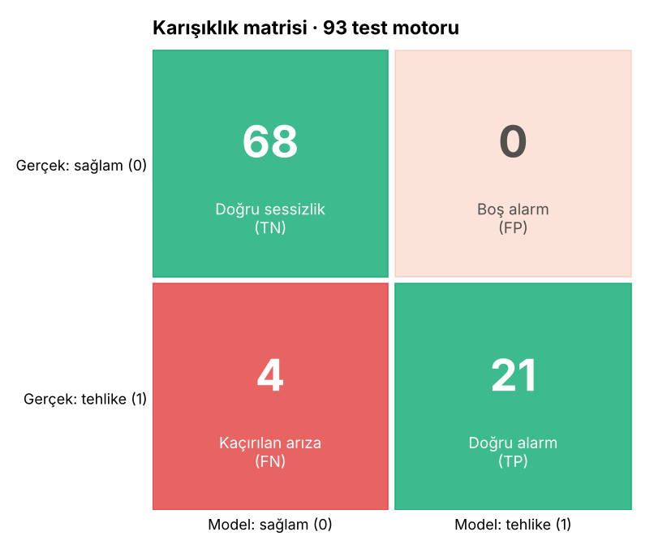
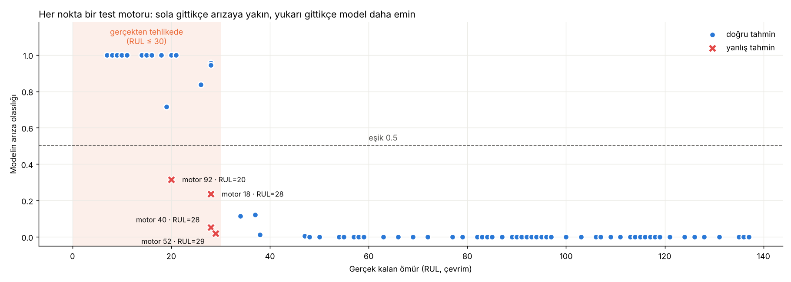
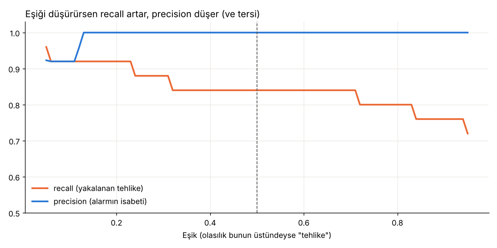

# Ders 7 · Test et

Kod: `src/evaluate_binary.py`. Model, eğitimde **hiç görmediği** 93 test motorunda, her motorun son 50 çevrimiyle sınanıyor.

## Önce kavramlar (S14–S17, örnek sayılarla)

Örnek: 25 motor tehlikede. Model 27'sine "tehlike" diyor, bunların 24'ü doğru.

| | Model: tehlike | Model: sağlam |
|---|---|---|
| **Gerçek: tehlike (25)** | TP = 24 | FN = 1 |
| **Gerçek: sağlam (68)** | FP = 3 | TN = 65 |

- **Precision** = TP / (TP + FP) = 24/27 = **0.89** → "Alarm çaldığında %89 haklıyız"
- **Recall** = TP / (TP + FN) = 24/25 = **0.96** → "Tehlikedeki motorların %96'sını yakaladık"
- **F1** = 2·P·R / (P + R): ikisinin harmonik ortalaması

**Hangisi daha kötü?** Uçak motorunda **kaçırılan arıza (FN)**. Boş alarmın bedeli bir muayene ve hangar saati.
Kaçırılan arızanın bedeli uçuşta motor kaybı, emniyet riski, AOG (aircraft on ground) maliyeti. → **Recall öncelikli.**

**Eşiği düşürmek:** Eşik 0.5 → 0.3 olursa daha fazla motora "tehlike" denir. Recall ↑, precision ↓.

## Gerçek sonuçlar (eşik 0.5)

| | LSTM (50 çevrim) | Lojistik regresyon (tek satır) | Referans proje |
|---|---|---|---|
| accuracy | 0.957 | 0.925 | 0.97 |
| precision | **1.000** | 1.000 | 0.92 |
| recall | 0.840 | 0.720 | **1.00** |
| F1 | 0.913 | 0.837 | 0.96 |

- **Hiç boş alarm yok** (FP = 0). Model "tehlike" dediyse gerçekten tehlike.
- **4 arıza kaçırıldı** (FN = 4). Model fazla temkinli; S16'ya göre uçakta istediğimiz şeyin tersi.
- Derin öğrenme, geçmişi görmeyen klasik modelden belirgin şekilde iyi: recall 0.72 → 0.84.
- Referans projeyle fark: onlar 25 sütun ve bir sonraki çevrimin etiketini kullanıyor; tek bir eğitim koşusunun sonucu.
  93 motorluk testte 1 motor = %4 recall. Bu ölçekte farklar büyük ölçüde rastgelelik.

## Kaçırılan 4 motor

| Motor | Gerçek RUL | Olasılık |
|---|---|---|
| 52 | 29 | 0.02 |
| 40 | 28 | 0.05 |
| 18 | 28 | 0.24 |
| 92 | 20 | 0.32 |

Dördünden üçü **sınırda** (RUL 28–29). Model bunlar için "henüz 30'un dışında" diyor; birkaç çevrim geç kalıyor.
Bu, keskin 30 sınırının doğal sonucu: 29 ile 31 arasındaki fark sensörde neredeyse görünmez.
Asıl dikkat edilmesi gereken **motor 92** (RUL 20, olasılık 0.32).

## Eşik ayarı: mühendislik kararı

| Eşik | TN | FP | FN | TP | Precision | Recall |
|---|---|---|---|---|---|---|
| 0.50 | 68 | 0 | 4 | 21 | 1.000 | 0.84 |
| 0.30 | 68 | 0 | 3 | 22 | 1.000 | 0.88 |
| 0.20 | 68 | 0 | 2 | 23 | 1.000 | **0.92** |
| 0.10 | 66 | 2 | 2 | 23 | 0.920 | 0.92 |
| 0.05 | 66 | 2 | 1 | 24 | 0.923 | 0.96 |

**Eşik 0.2 bedava bir iyileştirme:** hiç boş alarm eklemeden recall 0.84 → 0.92.
Eşik 0.1'de çıkan 2 "boş alarm" motor 58 (RUL 37) ve 77 (RUL 34). Yani zaten 30'un hemen dışındalar; bakımcı açısından makul uyarılar.

> Dürüstlük notu: Eşiği test sonucuna bakarak seçersek test seti artık tarafsız değildir. Doğru yöntem eşiği **doğrulama**
> verisinde seçip testte bir kez ölçmektir. Burada tablo öğretmek için gösterildi.

## Çıktılar

- `outputs/test_predictions.csv`: her test motoru için gerçek RUL, gerçek etiket, olasılık, tahmin
- `outputs/confusion_matrix.png`, `outputs/test_engines.png`, `outputs/threshold_sweep.png`
